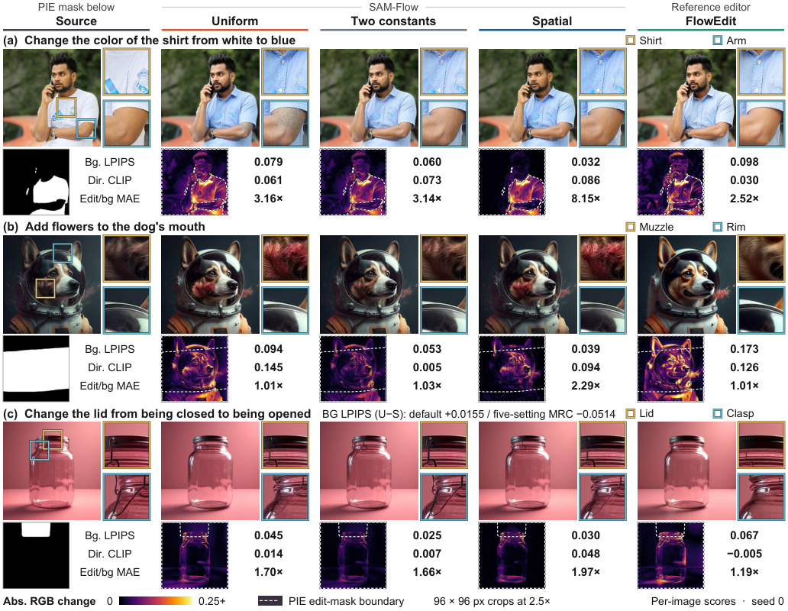

<h1 align="center">Localized, or Just Lighter?</h1>
<p align="center"><strong>Attributing Background Preservation in Flow-Based Image Editing</strong></p>
<p align="center">
  <a href="manuscript/A_ICME_Main.pdf">Paper (PDF, with references)</a> ·
  <a href="REFERENCES.md">All 43 references</a> ·
  <a href="manuscript/A_ICME_Supplement.pdf">Supplement</a> ·
  <a href="reproduction/Atlas_900_outputs.pdf">Image gallery</a> ·
  <a href="https://github.com/leiyurun3-sudo/localized-or-just-lighter/releases/download/v21.1/Localized-or-Just-Lighter-v21.1-complete.zip">Download everything</a> ·
  <a href="docs/research-guide.md">中文导读</a>
</p>

A spatial mask can keep the background of an edited image closer to the source. How much of that gain comes from **where** the editor acts, and how much comes from **how strongly** it acts? We study both effects in two training-free editors built on FLUX.1-dev. One pulls an image toward its source trajectory. The other, SAM-Flow, gates an editing displacement away from the source.



All four configurations turn the shirt blue. The crops reveal a gray patch below the sleeve under uniform editing. The dog gains red texture with no clearly identifiable flowers, and the jar stays closed in every output. The heatmaps use the same RGB-change scale across rows. [Browse all 900 outputs](reproduction/Atlas_900_outputs.pdf)

## What changes when we match strength?

**A correction toward the source.** Across 40 source images, spatial weighting raises background LPIPS by 0.0362 at the default coefficient. Matching the actual correction magnitude at each step reverses the ranking. Spatial weighting lowers background LPIPS by 0.0100 under either reference profile.

**SAM-Flow.** Two spatially constant gains, fitted separately for each image, recover 84.5% of the default background gain on the 42 images with background pixels. Across all 50 images, mean directional CLIP falls from 0.0841 to 0.0521. Spatial allocation also changes *where* pixels move. At the default setting, the edit-to-background MAE ratio averages 4.00 for spatial allocation and 2.11 for uniform allocation.

**At comparable edit response.** Matching directional CLIP within each image over four strengths from 0.25 to 1.0 leaves 40 images with overlapping response ranges. Spatial allocation retains 21.3% of the default background gain on these same images. The mean difference in background LPIPS (uniform minus spatial) is 0.0263, with a 95% interval of [0.0169, 0.0370]. [Figure and per-source results](data/README.md)

## Reproduce the results

From the repository root, run the following command to recover the main estimates from the archived scores. It requires only the Python standard library.

```bash
python reproduction/reproduce.py
```

For paired bootstrap intervals, install NumPy and run `python reproduction/reproduce.py --ci`. Each paper figure can also be regenerated from the included measurements and image layers. For example, to redraw the qualitative comparison and the matched-response results:

```bash
python -m pip install -r figures/requirements.txt
python redraw.py 3 4
```

The editable SVGs are written to `figures/generated/`. [Figure scripts](scripts/) · [Plot inputs](data/figures/) · [Reproduction guide](docs/reproduction.md) · [Experiment implementations](experiments/README.md)

## Paper and references

The six-page [paper](manuscript/A_ICME_Main.pdf) includes its full bibliography on page 6. The [43 references](REFERENCES.md) are also readable on GitHub in the paper’s citation order. The [LaTeX manuscript](paper/main.tex) and [bibliography source](paper/references.tex) are provided alongside the [53-page supplement](manuscript/A_ICME_Supplement.pdf). A separate [literature coding sheet](reproduction/literature/control_audit.csv) records which comparisons were reported in the 24 papers sampled for the audit.

[Data and upstream credits](docs/sources.md) · [Evidence index](reproduction/EVIDENCE_INDEX.md) · [Human-evaluation protocol and blank forms](human-evaluation/README.md)
