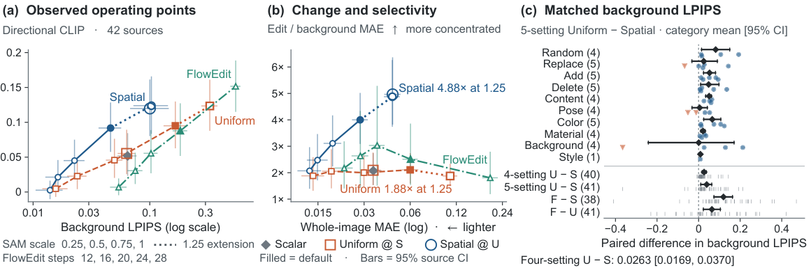

# Data and figures

The seed 0 figure shows the original scan. The solid SAM-Flow curves cover strengths 0.25, 0.5, 0.75 and 1.0. Open markers at 1.25 extend beyond the native gate range. The four-setting estimate averages 40 sources with overlapping directional-CLIP ranges. Including 1.25 gives 41 sources.

| Material | Location |
| --- | --- |
| Background LPIPS in the crossed allocation and magnitude conditions | [Figure 1 measurements](figures/cells.json) |
| Measured operating points and confidence intervals | [Operating points CSV](figures/operating_points.csv) |
| Four- and five-setting per-source estimates, trajectories and mask inputs | [Figure data](figures/) |
| All 900 SAM-Flow / FlowEdit scan outputs on 50 source images | [Image atlas](../reproduction/Atlas_900_outputs.pdf) · [Original PNG archive](https://github.com/leiyurun3-sudo/localized-or-just-lighter/releases/download/v21/A_DoseLens_scan900_20261119T012536Z_6206_images.zip) |
| Seed 0 and seed 1 score tables and four-setting comparison, plus partial seed 2 scores | [Seed comparison](../reproduction/analysis/sam_seed_repeat/) |
| Source artwork and plot code | [Editable SVGs](../figures/archive/) · [Rendering scripts](../scripts/) |
| PIE-Bench image and mask provenance | [Credits and terms](../docs/sources.md) |
