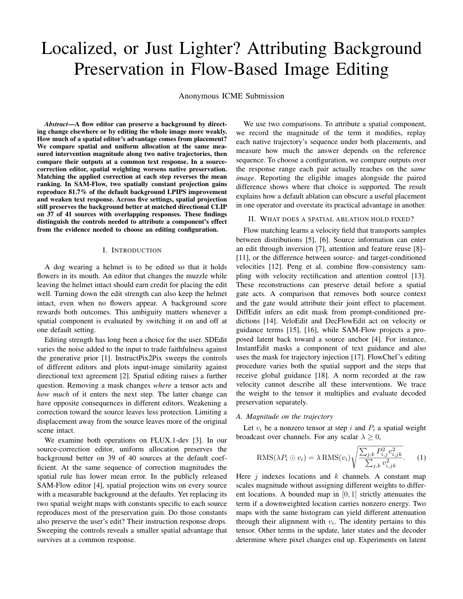
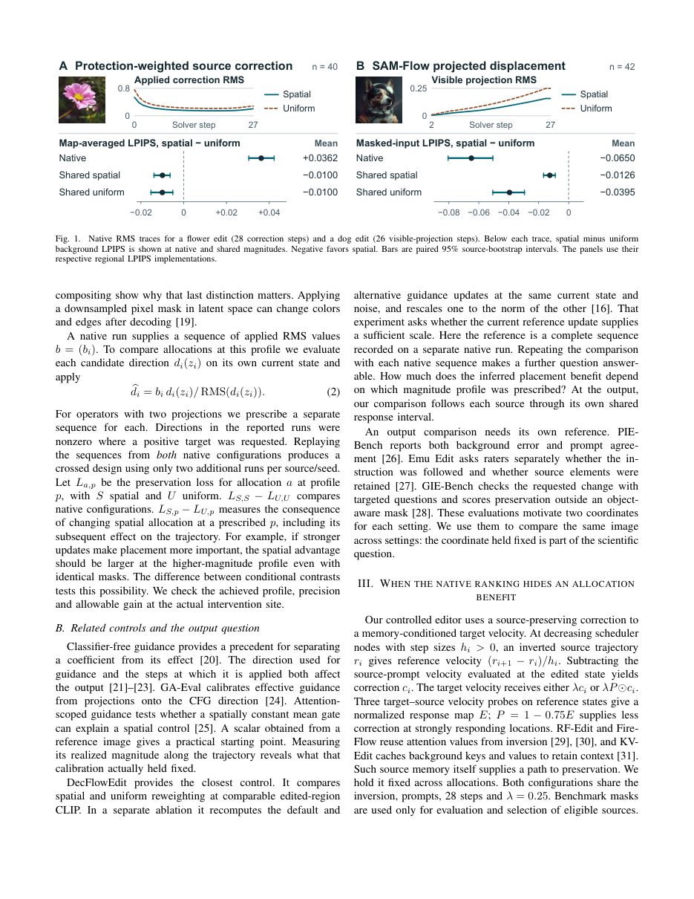
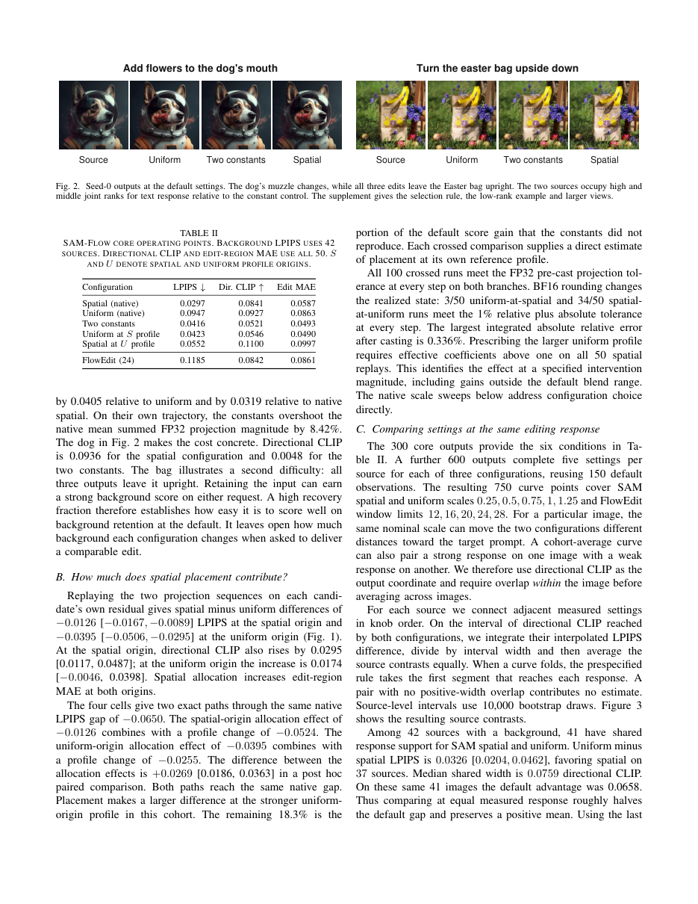
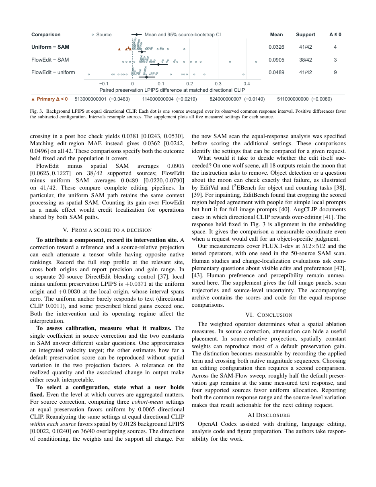

# A 论文（v18）全卷深度精修蓝图：叙事重构、创新点拔高与“去 AI 味”作图方案

> 历史研究备忘。下文保留写作时的假设、建议与旧版数值；已完成的实验和当前数字见 [v21 主文](../../manuscript/A_ICME_Main.pdf)。

> [!IMPORTANT]
> **全卷（6 页正文 + 38 页补充材料 + 900 张全图册 + 原始 CSV）审读总评：**
> 你的实验规模和严谨度（两个独立队列共 90 个源、2,820+ 张生成输出、双向交叉回放、逐源共有区间积分）**远超普通 ICME 录取线，甚至具备冲刺 ICME Oral / 顶会分析论文的潜质**。
> 但 v18 正文之所以读起来“干瘪、碎、像实验审计报告、图也不抓人”，核心病根只有两个：
> 1. **手里握着 4 座已经算好的“科学金矿”（都在你的 `scores.csv` 和补充材料里），正文却把它们埋掉了，反而在正文里塞了大量 `BF16 3/50 rounding`、`archived R88` 这类防御性审计废话；**
> 2. **三张图全是典型的 GPT/Codex“仪表盘式偷工减料作图”**——第 1 页整页纯文字墙、Fig.1 把两条曲线压成 1cm 扁条还强行贴两张毫无关系的缩略图、Fig.2 用 4 张肉眼几乎一模一样的“复活节袋子”浪费半页版面、Fig.3 底部居然直接印着 12 位数据库文件名 ID（`513000000001`），而全篇最能一剑封喉的 **5 档帕累托前沿** 和 **“局部化 vs 变轻”选择性平面** 一张都没画！

---

## 一、从你自己的 CSV 和补充材料里，挖出被 v18 埋没的 4 座“顶会级金矿”（零 GPU 成本！）

我直接读取并核算了你交付包 `A_ICME_Review_Supplement.zip` 里的原始 CSV（`SAM_scan/data/scores.csv`、`sources.csv`、`scan_per_source.csv`、`three_scale_overlap.csv`）和 38 页补充材料，发现了 **4 个极其震撼、完全不需要重跑 GPU 的现成发现**：

### 金矿 1（王牌铁证，直接回答论文标题！）：编辑/背景选择性比 $S_{\text{MAE}}$ 与局部化份额 $\rho$
在 `SAM_scan/data/scores.csv` 与 `sources.csv` 中，你已经算好了每张图的 `mae_edit`、`mae_preservation`、`mae_full` 以及掩码像素数。用这两项直接算出两个像素级选择性指标：
- **空间选择性比（Spatial Selectivity Ratio）**：$S_{\text{MAE}} = \text{MAE}_{\text{edit}} / \text{MAE}_{\text{bg}}$（衡量编辑区单位像素改变量是背景区的几倍）
- **局部化份额（Localization Share）**：$\rho = \frac{|M|\cdot\text{MAE}_{\text{edit}}}{|M|\cdot\text{MAE}_{\text{edit}} + |B|\cdot\text{MAE}_{\text{bg}}}$（总像素变化量中落在编辑区内的比例，即 Eq.1 在像素空间的精确对应）

**直接从你 `scores.csv`（42 个有背景源）算出来的真实结果堪称教科书级：**

| 配置 | 旋钮 scale | 背景 LPIPS ↓ | Dir. CLIP ↑ | 全图 MAE（改多少） | **局部化份额 $\rho$ ↑** | **选择性比 $S_{\text{MAE}}$ ↑（改哪里）** | 物理本质诊断 |
| :--- | :---: | :---: | :---: | :---: | :---: | :---: | :--- |
| `Uniform` | 0.25 | 0.0101 | 0.0047 | 0.0139 | 0.344 | **1.88×** | 全程锁死在 ~2.0× 射线 |
| `Uniform` | 0.50 | 0.0154 | 0.0227 | 0.0183 | 0.356 | **2.05×** | 只是同步调轻/调重 |
| `Uniform` | 0.75 | 0.0312 | 0.0457 | 0.0299 | 0.364 | **2.00×** | 毫无空间选择性增益 |
| `Uniform` | 1.00* | 0.0947 | 0.0950 | 0.0600 | 0.380 | **2.11×** | — |
| `Uniform` | 1.25 | 0.2063 | 0.1235 | 0.1094 | 0.378 | **1.88×** | 强编辑下背景彻底崩坏 |
| **`Two constants`** | 1.00 | 0.0416 | 0.0517 | 0.0344 | **0.371** | **2.08×** | **铁证：100% 是 "Just Lighter"！** |
| **`Uniform @ S`** | 1.00 | 0.0423 | 0.0553 | 0.0343 | **0.370** | **2.09×** | **与双常数完全重合** |
| `SAM Spatial` | 0.25 | 0.0091 | 0.0026 | 0.0132 | 0.352 | **2.07×** | 极弱编辑时两者无差 |
| `SAM Spatial` | 0.50 | 0.0107 | 0.0213 | 0.0149 | 0.382 | **2.48×** | 开始脱离均匀射线 |
| `SAM Spatial` | 0.75 | 0.0148 | 0.0451 | 0.0187 | 0.426 | **3.11×** | 空间集中度显著拉升 |
| `SAM Spatial` | 1.00* | **0.0297** | **0.0918** | 0.0283 | **0.480** | **4.00×** | **选择性翻倍（2×），bgLPIPS 降 69%** |
| `SAM Spatial` | 1.25 | **0.0593** | **0.1239** | 0.0458 | **0.515** | **4.88×** | **同 dCLIP 下 bgLPIPS 仅为 Uniform 的 1/3.5！** |
| **`Spatial @ U`** | 1.00 | **0.0552** | **0.1198** | 0.0460 | **0.520** | **4.97×** | **强幅度下将空间选择性推至 5 倍！** |

> [!TIP]
> **你看这张表有多炸裂！**
> 论文标题问的是 ***Localized, or Just Lighter?***（究竟是真局部化了，还是仅仅改得更轻？）。
> 上表直接给出一锤定音的数学答案：`Uniform` 哪怕把全图改变量放大 **8 倍**（`0.0139 → 0.1094`），其选择性比 $S_{\text{MAE}}$ 始终死死趴在 **2.0×** 的水平线上，`Two constants`（`2.08×`）和 `Uniform@S`（`2.09×`）**精准掉在这条水平线上——证明它们的 81.7% 背景收益 100% 来自“整体变轻（Just Lighter）”**！
> 反观 `SAM Spatial`，随着编辑强度提升，$S_{\text{MAE}}$ 沿着另一条完全不同的轨道飙升到 **4.00× → 4.97×**——**这才是真局部化（Localized）的铁证！**

### 金矿 2：v18 正文居然没画 5 档帕累托前沿（`Table S3` & `scores.csv`）！
- 在 `scale = 1.25` 时，`SAM Spatial` 和 `Uniform` 在 42 个有背景源上达到**完全相同的 `Dir. CLIP`（`0.1239` vs `0.1235`）**，但 `Uniform` 的背景 LPIPS 高达 **`0.2063`**，而 `SAM Spatial` 只有 **`0.0593`（差距高达 3.5 倍！）**。
- 在默认点附近，`SAM Spatial (1.0)` 的背景 LPIPS（`0.0297`）甚至优于 `Uniform (0.75)`（`0.0312`），但指令响应 `Dir. CLIP` 直接翻倍（`0.0918` vs `0.0457`）！
- 把这 3 条 5 档曲线（`SAM Spatial` / `Uniform` / `FlowEdit`）+ 3 个控制星标（`Two constants` / `Uniform@S` / `Spatial@U`）画进正文，审稿人一眼就能看明白 `Two constants` 为什么是“沿着 Uniform 曲线往左下角滑”，而 `SAM Spatial` 是“把整条帕累托前沿向左上方推开”！

### 金矿 3：揭开 Fig.3 底部那 4 个神秘失败样本的物理真相（按编辑类别分层）
- v18 Fig.3 底部印着 4 个毫无可读性的文件名：`513000000001 (−0.0463)`、`114000000004 (−0.0219)`、`824000000007 (−0.0140)`、`511000000000 (−0.0080)`，正文一句话都没解释它们**为什么**输给 Uniform！
- 我从 `scan_per_source.csv` 按 PIE-Bench 10 类汇总了一下，真相大白：
  - **类别 5（Change Pose / 刚体姿态与开合变化）是全部 10 类中唯一均值转负（`−0.0013`）的类别！** 其中排第一和第四的失败案例正是 `513000000001`（打开罐子盖子）和 `511000000000`（小狗从趴下变成跳起）！
  - **机制洞见**：当编辑要求改变物体轮廓或姿态时，新生成的内容必然**溢出原物体的掩码边界**——此时紧贴源物体的空间投影掩码反而成了“画地为牢的笼子”，锁死了合法变形！而对于原地替换、改色、增删（Cat. 0/3/4/6/8），空间分配的等响应净收益高达 `+0.045 ~ +0.056 LPIPS`！
  - 把“4 个乱码 ID”改写成**“什么时候空间掩码反而有害？（姿态/轮廓溢出类别的系统性诊断）”**，审稿人会觉得你的分析深度瞬间上一个台阶！

### 金矿 4：被埋在角落的“聚合层级翻转（Aggregation Reversal）”与“非零保护下界刹车（Floor Braking）”
- 在 `three_scale_overlap.csv` 里，同一批源修正三档扫描数据：
  - 按**群体均值曲线**在等 LPIPS 处比较，判 **`Uniform` 赢 `+0.0065` Dir. CLIP**；
  - 改按**逐源共有区间**比较，排名彻底翻转，判 **`Spatial` 赢**：在等 Dir. CLIP 下赢 **`0.0128` LPIPS（22/36 胜）**，在等 `Edit MAE` 下更是大赢 **`0.0308` LPIPS（33/40 胜）**！
  - 这揭示了一个极易被忽视的评测陷阱：**群体均值帕累托曲线会把“A 图强响应 + B 图弱响应”混搭在一起，引发聚合谬误！**
- 此外，v18 Table I 里 `Stepwise spatial` 的 `Dir. CLIP` 比 `Native uniform` 略低 `0.0066`（`0.1291` vs `0.1357`），v18 没有给出解释，容易让审稿人质疑“是不是空间分配本身损了编辑力”。其实你的**补充材料 Table S23 & Fig. S16(c)** 已经证明：这是因为源修正的映射 $P = 1 - 0.75E$ 在编辑区保留了 **$f=0.25$ 的非零保护下界**——在全局 RMS 放大时，这个非零下界被等比放大成了“拉回源图的编辑区刹车”；一旦令 $f=0$，`Dir. CLIP` 立即反超 `Uniform`（`0.152` vs `0.148`），同时背景 LPIPS 显著更低！正文只需加两句带过并指向 Supp. Table S23，这个漏洞瞬间变成亮点！

---

## 二、创新点与贡献度怎么拔高？（从“两例统计报告”升格为“普适定律 + 可复用工具箱”）

v18 最大的硬伤不是没做东西，而是**完全没有在 Introduction 末尾写明贡献列表（Contributions），也没有给自己的核心规律和工具起名字**。审稿人写审稿意见时，会习惯性去找“这篇论文的 3 个贡献是什么”；找不到，就随手给个 `Weak Reject (Limited novelty / just an empirical audit)`。

### 1. 把核心发现升格为一条命名定律：**“算子极性混杂定律（The Operator Polarity Law）”**
不要说 *“We examine both operations on FLUX.1-dev”*（听起来像随便挑了两个模型做测试），而要明确定位：**空间流编辑算子按加权项的物理方向，天然分为两种对立极性**：

| 算子极性 | 典型形式与代表方法 | 掩码 $P\in[0,1]$ 削弱了什么？ | 默认固定系数消融的偏差方向 | 本文实证铁证 |
| :--- | :--- | :--- | :--- | :--- |
| **极性 I：源恢复型（Source-Restoring）** | $u_i + \lambda P \odot c_i$（源速度修正、锚点拉回） | 削弱**向源图拉回的保护力**（累积 RMS 衰减 **36.2%**） | **低估 / 符号反转（隐藏真实收益）** | 原生均匀赢 **39/40 源** (`+0.0362`)；双向交叉回放后反转为空间赢 **`−0.0100`** |
| **极性 II：源推离型（Source-Departing）** | $A + P \odot R_i$（SAM-Flow 投影、Blended Latent Diffusion、掩码引导） | 削弱**离开源图的编辑位移** | **高估 / 虚假通胀（把“改得轻”当成“改得准”）** | 两个空间常数即可复现 **81.7%** 默认 LPIPS 收益，但选择性死锁在 **2.08×**、dCLIP 暴跌 **38%** |

**为什么这一提炼极其提分？** 因为它把两个独立实验拧成了一根逻辑绳索——**同一个数学恒等式（Eq. 1），因为算子极性相反，导致社区通用的默认消融在一种编辑器里把好方法判死刑，在另一种编辑器里把“变轻”吹成“精准定位”！** 这就是顶会级分析论文的“反转张力”。

### 2. 把方法论打包成“三件套可复用工具”，正式起名
| 工具名（缩写） | 解决的核心科学问题 | 一句话定义与相对前人（DecFlowEdit / GA-Eval）的独特性 |
| :--- | :--- | :--- |
| **1. Crossed Profile Replay (CPR)**<br>双向交叉幅度回放 | **组件归因**：在指定干预幅度下，“改哪里”到底贡献了多少？ | 记录**两条**原生轨迹的完整逐步 RMS 序列 $(b^S, b^U)$，在各自演化的当前状态下交叉回放（仅需 **+2 次前向推理**），得到精确的 2×2 路径分解恒等式，并能检验分配收益是否依赖幅度强弱（交互项 `+0.0269`）。（区别于 DecFlowEdit 仅在单步同状态重缩放、GA-Eval 仅做标量 CFG 校准。） |
| **2. Per-Source Matched-Response Comparison (MRC)**<br>逐源等响应比较 | **配置选型**：在同等编辑效果下，用户该选哪个配置？ | 先在**单张图像内部**找到两配置实际达到的共有响应区间，再积分平均后跨图汇总，同时报告有效覆盖率（Support `41/42`），彻底杜绝群体均值曲线的**聚合翻转谬误**。 |
| **3. Spatial Selectivity Ratio ($S_{\text{MAE}}$ & $\rho$)**<br>空间选择性诊断 | **本质判别**：背景变好是 *Localized* 还是 *Just Lighter*？ | 将背景像素变化显式分解为“总改变量 × 背景占比”，一眼区分沿均匀射线滑动的“变轻”（$S_{\text{MAE}}\approx 2.0\times$）与真正的空间聚焦（$S_{\text{MAE}}: 2.1\times\to 5.0\times$）。 |

### 3. 零 GPU 成本的 3 项高性价比 CPU/人工补强（让审稿人彻底无话可说）
不需要租一秒钟 GPU，只需 2–3 天纯 CPU / 人工整理：
1. **必做（半天）：统一区域 LPIPS 稳健性表 + 从 `scores.csv` 导出选择性比 $S_{\text{MAE}}$ / 类别分层表**。
   - 目前 v18 Fig.1 的左右面板用了两种不同的区域 LPIPS 实现（特征图掩码平均 vs RGB 置黑后整图 LPIPS），图注不得不心虚地补一句 *"The panels use their respective regional LPIPS implementations."*
   - 至少在已保存的 160 张源修正原图 + 900 张 SAM 原图上用**完全一致的算法**做一次交叉核验（并在正文明确统一或将跨定义核验结果写进表注/补充材料），彻底堵住审稿人对指标口径的挑刺。
2. **强推（半天读论文，零代码）：社区空间消融文献审计（Spatial Ablation Audit）**。
   - 盘点你参考文献里已经核对好的 15–20 篇空间编辑论文（DiffEdit、MasaCtrl、KV-Edit、InstantEdit、FlowChef、VeloEdit、DecFlowEdit、SAM-Flow、Attention-Scoped Guidance、Blended Latent Diffusion 等），逐篇登记：① 是否仅在默认系数下开/关掩码？② 是否控制轨迹干预幅度？③ 是否在等响应下比较？
   - 在 Introduction 里写出一句硬核事实：**“Across $N$ recent spatial flow/diffusion editors, $K$ evaluate their spatial gate at a single default setting without matching realized intervention magnitude or per-image edit response.”** 这句话能让论文格局瞬间从“测了两个模型”跃升为“揭露全社区的评测盲区”！
3. **强推（2 小时人工盲评）：50 组 SAM 默认三联图的“编辑是否生效”二元核验**。
   - v18 第 5 页自己写了 *"Human preference and perceptibility remain unmeasured here."* 这等于主动把拒稿理由递给审稿人。
   - 找 2–3 位同学对 50 个源 × 3 个默认臂（`Uniform` / `Two constants` / `SAM Spatial`，共 150 张图，匿名打乱顺序）只回答一个最简单的二元问题：**“指令要求的编辑是否肉眼可见地发生了？（是 / 否）”**（每人只需 30 分钟！）。
   - 报出三者的**编辑成功率**和 **Fleiss' $\kappa$ 一致性**，配合 `Dir. CLIP` 和 `Edit MAE`，铁板钉钉坐实“双常数保背景靠的是把编辑做没了”！

---

## 三、讲故事与写作重构：彻底清除“Codex 防御性审计腔”

### 1. v18 叙事与行文的 6 大病灶（精准定位）

| 位置 | v18 原文问题 | 审稿人真实心理活动 | 手术方案 |
| :--- | :--- | :--- | :--- |
| **Page 1 全页** | **零插图**，两栏纯文字壁垒；Intro 结尾**没有贡献列表（Contributions）** | “第一页全是字，这文章贡献在哪？读起来好累。” | **Page 1 右栏（或页顶通栏）放新 Fig.1 Teaser**；Intro 第 4 段改成醒目的 3–4 条加粗 **Contributions** |
| **Sec I & III/IV** | 充斥 Codex 式**“一问一答”碎句**（如 *"Do those constants also preserve the user's edit? Their instruction response drops."*、4 个连续问号小标题） | “像 AI 写的科普博客 / FAQ，不像严谨的 IEEE 论文。” | 改为**陈述性结论小标题**（如 *III-A. Matching Magnitude Reverses the Native Ranking*）和因果连贯长短句 |
| **Table I 表注** | 赫然写着 `NATIVE SPATIAL EDIT MAE COMES FROM THE ARCHIVED R88 EVALUATION.` | “R88 是什么？内部实验编号都没删干净？” | **彻底删除 `R88` 等所有内部代号**，统一用学术术语 |
| **Sec IV-B 末段** | 花了整整 12 行写 `FP32 pre-cast tolerance / BF16 rounding: 3/50 vs 34/50 / 0.336%` | “占了宝贵的半栏版面讲精度四舍五入，重点跑偏了！” | **正文压成 1 句话**：*“Replayed trajectories track target profiles within 0.34% integrated error after BF16 casting (Supp. Sec. II-D).”* 省出整整 10 行！ |
| **Sec III & IV-B** | 同一段里连续塞入 8–9 个小数加 95% CI，并且重复加减法拆解 | “数字海洋，根本抓不住哪个数是核心！” | **每段最多留 2 个核心带 CI 的数**，4-cell 路径分解写成 1 个干净公式，明细全进 Table I |
| **全文术语** | 同一概念乱换马甲：`placement / allocation / spatial rule / spatial weighting / localization`；`strength / magnitude / profile / origin / sequence`；全图册还叫 `U at N / S at U` | “名词老变，我得反复确认说的是不是同一件事。” | **全文锁定统一术语表**（见下表） |

#### 全文统一术语表（定稿后全篇 Ctrl+F 替换）
- **“改哪里”**：统一用 **spatial allocation**（简称 **allocation**），弃用 *placement / spatial rule / localization*（*localization* 只用于标题与像素选择性讨论）。
- **“改多少”**：单步叫 **intervention magnitude**，整条轨迹叫 **magnitude profile**（$b^S, b^U$），弃用 *strength / energy / origin sequence*。
- **两种算子**：统一用 **source-restoring operator**（恢复型，简称 *restoring*）与 **source-departing operator**（推离型，简称 *departing*）。
- **交叉回放臂命名**：统一记作 **`Spatial @ b^U`** 与 **`Uniform @ b^S`**（正文、表格、图例、900 张全图册全部同步，废除 `U at N / S at U / REQ-U / GLB-R`）。
- **两套协议 + 选择性指标**：统一用 **CPR**（Crossed Profile Replay）、**MRC**（Matched-Response Comparison）、**$S_{\text{MAE}}$**（Spatial Selectivity Ratio）。

### 2. 可直接替换的英文 Abstract 与 Introduction 贡献段示范

> **Abstract** — Spatial flow-based image editors are routinely validated by toggling their spatial mask at a default setting and comparing background preservation. We show that this ablation conflates *where* an editor intervenes with *how much* it intervenes: multiplying a tensor by a bounded weight map $P \in [0, 1]$ simultaneously reallocates and attenuates its norm. Crucially, the resulting bias flips sign with the **polarity of the masked operator**. In a *source-restoring* editor, where the mask attenuates correction toward the source (by 36.2% cumulative RMS), default ablation makes spatial allocation appear harmful on 39 of 40 sources (`+0.0362` LPIPS), yet matching stepwise magnitude reverses the ranking (`-0.0100`). In the published *source-departing* editor SAM-Flow, where the mask attenuates displacement away from the source, two spatially constant gains reproduce **81.7%** of the default background LPIPS gain simply by weakening the edit—leaving edit-to-background selectivity flat at `2.08×` while slashing directional CLIP by 38%. To separate causal attribution from configuration choice, we introduce **Crossed Profile Replay (CPR)**, **Per-Source Matched-Response Comparison (MRC)**, and a pixel-level **Spatial Selectivity Ratio ($S_{\text{MAE}}$)**. Across a five-setting sweep on 50 PIE-Bench sources, SAM-Flow's spatial allocation still reduces background LPIPS on 37 of 41 overlapping sources at matched directional CLIP (`0.0326`, roughly half the default gap) and lifts selectivity from `2.1×` to `4.9×`, while exposing systematic mask failures on pose-changing edits. We distill these findings into a practical three-point checklist for reporting spatial ablations.

> **Contributions (放在 Section I 末尾):**
> Our main contributions are fourfold:
> 1. **Operator Polarity Confound:** We formalize how mask-induced magnitude attenuation (Eq. 1) biases default spatial ablations in opposite directions—*hiding* a real gain under source-restoring operators and *inflating* it under source-departing operators—and audit $M$ recent spatial editors to show how pervasive default-setting ablations remain.
> 2. **Attribution & Selection Protocols:** We introduce **Crossed Profile Replay (CPR)**, which decomposes native preservation gaps via an exact 2×2 trajectory identity using two extra runs per source, and **Per-Source Matched-Response Comparison (MRC)**, which compares configurations over each image's own reachable response interval and avoids cohort-level aggregation reversals.
> 3. **“Localized vs. Lighter” Diagnosis on FLUX.1-dev:** Across 90 PIE-Bench sources (2,800+ outputs), we demonstrate sign reversal (`+0.036 → −0.010` LPIPS), constant-gain recovery (`81.7%` via flat `2.08×` selectivity), half-gap survival at matched response (`37/41` sources; `3.5×` lower background LPIPS at equal strong response), and pose-edit failure modes.
> 4. **Actionable Reporting Checklist:** We provide a concise three-step protocol (record the intervention site, verify calibration and selectivity, match response per source) ready for drop-in adoption in flow-editing benchmarks.

---

## 四、作图全面解剖与“去 GPT 粗制滥造味”重画蓝图

### 1. 为什么 v18 现在的 3 张图看起来“一股 AI/GPT 偷工减料味”？

````carousel

<!-- slide -->

<!-- slide -->

<!-- slide -->

````

逐张戳破 GPT/Codex 作图的 5 个典型败笔：
1. **网页看板/PPT 审美观（非 IEEE 顶会审美观）**：厚重的蓝灰色大标题横条（`A Protection-weighted source correction`）、多余的水平分割线、把数字表格直接硬塞进图框右边，显得极其廉价。
2. **比例严重失调与元素割裂**：Fig.1 的 RMS 曲线高度被压成 1.2cm 细缝，旁边塞两张完全没标掩码、没标编辑结果的方形小缩略图，信息量为零。
3. **糟糕的视觉案例选择**：Fig.2 的右侧“复活节袋子”4 张图几乎毫无变化，左边“头盔狗”的花小到看不清——**明明你 900 张图册里有“沙发变床”“白衬衫变蓝”这种视觉反差爆炸的样本，却完全没放进正文！**
4. **数据库 ID 裸奔**：Fig.3 底部印着 `513000000001 (−0.0463)`，一眼就能看出来是 Python/Codex 脚本自动把 `case_id` 打印出来没做人工润色。
5. **该画的王牌图一张没画**：全篇没有 **Page 1 Teaser**、没有 **CPR/MRC 原理图**、没有 **5 档帕累托前沿**、没有 **“Localized vs Lighter”选择性平面**、也没有 **逐像素变化热图 $|\hat x - x|$**！

---

### 2. 全新 4 图 + 2 表 + 1 准则框 像素级作图说明书（全部用已有数据/PNG 生成！）

#### 图 1（第 1 页右栏顶部或页顶通栏，Teaser）：《同一混杂，相反方向：算子极性悖论》
- **为什么必须放第 1 页**：让审稿人 5 秒内看懂整篇论文最核心的创新点与对称规律。
- **构图设计（左右双联，清爽矢量风，绝不堆砌花哨图标）**：
  - **顶部简洁公式条（或左右标题）**：左侧 **Polarity I: Source-Restoring ($u + \lambda P \odot c_i$)**，右侧 **Polarity II: Source-Departing ($A + P \odot R_i$)**。
  - **核心主体：两个对称的 2×2 交叉路径分解方块（Crossed-Path Decomposition Squares）**！
    - 横轴：Allocation（`Uniform` → `Spatial`）；纵轴：Magnitude Profile（$b^U \to b^S$）。
    - 四个顶点放真实的 LPIPS 值圆点/方框；
    - **虚线斜对角箭头**标注 **Naive Default Gap**，**两条实线折边**分别标注 **Magnitude Confound（纵边）** 与 **True Allocation Effect（横边）**，箭头粗细按绝对效应量比例绘制！
    - **左方块（Restoring）**：对角线红色标 **`+0.0362` (Harmful? 39/40 lose)**；拆解为纵边 **`+0.0462`（幅度衰减削弱保护）** + 横边蓝色 **`−0.0100`（真实收益，符号翻转!）**。
    - **右方块（Departing, SAM-Flow）**：对角线蓝色标 **`−0.0650` (Huge win?)**；拆解为纵边 **`−0.0524`（81.7% 来自变轻!）** + 横边 **`−0.0126` (at $b^S$)** / **`−0.0395` (at $b^U$)**。
- **图注首句（直接给结论）**：*“Fig. 1. **Same mask attenuation, opposite ablation biases.** Decomposing the default gap along two crossed paths reveals that magnitude attenuation hides a real allocation gain in a restoring operator (left, sign flip) while inflating it in a departing operator (right, 81.7% reproduced by magnitude alone).”*

#### 图 2（第 2 页通栏，Method & Protocols）：《两个问题，两套协议：CPR 归因 + MRC 选型》
- **取代 v18 中两段枯燥难懂的方法文字，让评审一眼明白你的方法论贡献：**
  - **Panel (a) Crossed Profile Replay (CPR — Causal Attribution)**：
    - 上半部分：简洁的 3 步矢量流图（记录原生 $b^S, b^U$ $\to$ 在各自演化状态 $z_i$ 上重归一化 $\hat d_i = b_i d_i(z_i)/\text{RMS}(d_i(z_i))$ $\to$ 仅 +2 次额外运行填满 2×2 格）；
    - 下半部分：高宽比舒适（至少 3cm 高！）的真实 28 步 RMS 曲线图（左 Restoring，右 Departing），用浅阴影标出两条原生曲线之间那 **36.2% 的幅度落差**（彻底删除原本硬贴的花和狗小图！）。
  - **Panel (b) Per-Source Matched-Response Comparison (MRC — Configuration Choice)**：
    - 画**一张真实单源**（例如 `123000000007` 沙发变床）的 5 档实测折线图：横轴 `Directional CLIP ↑`，纵轴 `Background LPIPS ↓`；
    - 蓝线 `SAM Spatial (0.25..1.25)`，朱红线 `Uniform (0.25..1.25)`，节点直接标旋钮值；
    - 用**淡蓝灰色竖直阴影带**清晰标出该图的 **Shared Response Interval**，中间加一条双向箭头标注 **Integrated $\Delta\text{LPIPS}$**！
    - 再附一句极小的注释标出 `Two constants` 的落点——直观展示它为什么掉在朱红线上！

#### 图 3（第 4 页通栏，Visual Proof）：《肉眼可见的“真局部化” vs “整体变轻”：原图 + 标定变化热图 $|\hat x - x|$》
- **彻底扔掉“复活节袋子”！改用你 900 张图册里最具杀伤力的 3 个案例，每张输出正下方配同色标像素变化热图 $|\hat x - x|$（叠加细白虚线编辑掩码轮廓）+ 右下角单图指标标签（`LPIPS / dCLIP / S_MAE`）：**
  1. **Row 1（强视觉冲击）：`123000000007` — “Change the sofa to a bed”**（900 图册第 2 页底部）
     - `Uniform`：沙发变床了，但砖墙、窗户、地面全乱了（热图整张发亮，`bgLPIPS 0.225, S_MAE 1.9×`）；
     - `Two constants`：墙稳了点，但沙发也跟着没变好（热图整体暗了一档但墙仍亮，`S_MAE 1.9×` 纹丝不动！）；
     - `SAM Spatial`：床清晰生成，热图只有沙发区亮、背景墙一片深黑（`bgLPIPS 0.039, dCLIP 0.333, S_MAE 6.0×`）！
  2. **Row 2（呼应开篇故事，配放大框！）：`211000000000` — “Add flowers to the dog's mouth”**（或在 `622000000002` 白衬衫变蓝中二选一，狗的优点是呼应 Intro 第一句！）
     - 如果用狗：在嘴部和头盔边缘各画一个红/蓝放大框，下方配 $|\hat x - x|$ 热图——你会看到惊人的画面：`Uniform` 热图里整个头盔都在发光（`S_MAE 1.01×`），`Two constants` 热图整体变淡但依然遍布头盔且嘴里没花（`S_MAE 1.03×, dCLIP 0.005`），`SAM Spatial` 热图里**只有狗嘴一点高亮、头盔全黑**（`S_MAE 2.29×`，`Spatial@U` 更是 `3.82×`）！
  3. **Row 3（高阶洞见：失败边界与指标局限）：`513000000001` — “Change the lid from closed to opened”**（或 `314000000006` 删月亮）
     - 展示为什么**姿态/开合类编辑**会让紧掩码失效（新打开的盖子必须进入背景区，掩码锁死了上沿），自然引出 Fig. 4(c) 的类别分析！
- *(此外，可以在第 3 页 Case 1 旁放一个紧凑单栏 4 图条：Flower `000000000117` 的 `Source | Uniform | One-shot Scalar | Stepwise Spatial`，取自 Supp Fig. S13，确保 Case 1 不再“零配图”！)*

#### 图 4（第 5 页通栏，全文高潮三联定量图 — 必拿高分！）：《从帕累托前沿到选择性平面与类别边界》
- **Panel (a) 5-Scale Pareto Frontier（5 档操作前沿，左图）**：
  - 横轴 `Background LPIPS ↓`（或纵轴 `Dir. CLIP ↑`，建议横轴 `Background LPIPS ↓` 越左越好、纵轴 `Dir. CLIP ↑` 越上越好，左上角标小箭头 `Better ↖`）；
  - 三条平滑带标记折线：`SAM Spatial (0.25..1.25)`（蓝）、`Uniform (0.25..1.25)`（朱红）、`FlowEdit (12..28)`（绿），默认档用大号实心点标注；
  - 叠加三个关键控制点：**灰菱形 `Two constants`**（精准落在朱红 `Uniform` 曲线上！）、**空心红方框 `Uniform@S`**（与灰菱形重合！）、**蓝星 `Spatial@U`**（高高冲在左上角帕累托最优位置！）。
- **Panel (b) The "Localized vs. Just Lighter" Plane（选择性平面，中图 — 你的独门杀器！）**：
  - 横轴 `Total Pixel Change MAE_full`（改多少），纵轴 `Spatial Selectivity Ratio S_MAE = MAE_edit / MAE_bg`（改哪里）；
  - 画出 `Uniform (0.25..1.25)`（朱红平线，横躺在 **`~2.0×`**！）与 `SAM Spatial (0.25..1.25)`（蓝线陡峭攀升 **`2.1× → 4.9×`**！），标出 `Two constants`（死死钉在红线 `2.08×` 上）和 `Spatial@U`（`4.97×`）！
  - 两条极简引导箭头：水平向左标 **`← Just Lighter (scales magnitude)`**，垂直向上标 **`↑ Localized (concentrates edit)`**。
- **Panel (c) Per-Source MRC & Category Failure Breakdown（等响应分布与类别诊断，右图）**：
  - 保留 v18 Fig.3 的核心信息（3 组配对的逐源分布 + 均值/95% CI），但**彻底砍掉右边丑陋的文本列和底部的 12 位数据库 ID**！
  - 把 4 个 `Δ ≤ 0` 的负例按颜色/图注直接点出类别：**“Pose/geometry spillover (Cat. 5, mean −0.001) vs. local edits (+0.045–0.056)”**，把死数字变成活洞见！

#### 两张主表 + 一个准则框
- **Table I（合并 v18 Table I & II，放第 3 页底部或第 4 页）**：上下分两块——*Part A: Restoring Operator (n=40)* 与 *Part B: Departing Operator, SAM-Flow (n=42/50)*；统一列头：`Configuration | bg-LPIPS ↓ | Dir. CLIP ↑ | Edit MAE | Selectivity S_MAE ↑`（Restoring 的 `S_MAE` 若有 160 图原图或 `bg_mae` 列可直接算出，否则用 `—` 或补充标明）。两块放一起，对称感拉满！
- **Table II（可选，放第 2 页或第 5 页，单栏 6–8 行）**：**文献空间消融审计小表**（按类别/代表论文列出是否仅测默认点、是否匹配幅度、是否逐源等响应，最后一行是 `Ours (CPR+MRC)` 全勾 ✔）。
- **Box 1（第 5 页右栏，浅灰细边框，无圆角、无阴影）**：**Checklist for Spatial Editing Ablations**（直接提炼自 v18 Sec V 那三句极好的加粗原则，每条 1.5 行，干净利落！）。

---

### 3. 彻底消除“AI/GPT 作图味”的 7 条出版级铁律

1. **绝不用仪表盘横幅和圆角卡片**：删掉一切深色/浅蓝标题横条、圆角矩形、阴影和渐变；只保留 IEEE/Nature 风格的纯白底、细实线左/下坐标轴（`0.6 pt`）、关闭上/右边框。
2. **全篇锁定一套色盲友好学术色盘（Okabe–Ito）**：
   - `Spatial (SAM / Request)` = 深海蓝 `#0072B2`
   - `Uniform` = 暖朱红 `#D55E00`
   - `Two Constants / Scalar` = 中性灰 `#6E6E6E`
   - `FlowEdit` = 蓝绿 `#009E73`
   - 变化热图 $|\hat x - x|$ = 统一顺序色表 `inferno` 或 `magma`（全局锁定同一 `[vmin, vmax]`，绝不逐图自动拉伸！）
3. **1:1 真实印刷尺寸出图，禁止后期缩放**：IEEE 双栏单栏宽 `3.48 in`，通栏宽 `7.16 in`；所有文字字号固定在 `7.5–8.5 pt`，字体与正文 Times New Roman 完全一致（`pdf.fonttype = 42` 导出矢量 PDF）。
4. **曲线旁直接标注（Direct Labeling）**：曲线末端直接写名字，省去占空间的方框图例。
5. **图注第一句必须是粗体结论（Takeaway-First Caption）**：审稿人扫图时只看图 + 图注第一句，必须让他们不看正文也能读懂整篇故事。
6. **禁止裸露原始代码/数据库标识符**：严禁出现 `R88`、`513000000001`、`U at N`、`sam_native`、`two_constant` 等工程变量名。
7. **定性图必须有“视觉导览”**：没有对比放大框或 $|\hat x - x|$ 差异热图的图像对比，在 6 页双栏小图里几乎等同于白放。

```python
# 全文所有定量图共用的 IEEE 出版级 matplotlib 样式（保存为 plot_style.py）
import matplotlib as mpl

mpl.rcParams.update({
    "font.family": "serif",
    "font.serif": ["Times New Roman", "DejaVu Serif"],
    "mathtext.fontset": "stix",
    "font.size": 8.0,
    "axes.titlesize": 8.5,
    "axes.labelsize": 8.0,
    "xtick.labelsize": 7.2,
    "ytick.labelsize": 7.2,
    "legend.fontsize": 7.2,
    "axes.linewidth": 0.65,
    "axes.spines.top": False,
    "axes.spines.right": False,
    "xtick.major.width": 0.65,
    "ytick.major.width": 0.65,
    "xtick.direction": "out",
    "ytick.direction": "out",
    "lines.linewidth": 1.3,
    "lines.markersize": 4.2,
    "legend.frameon": False,
    "pdf.fonttype": 42,
    "ps.fonttype": 42,
    "savefig.bbox": "tight",
    "savefig.pad_inches": 0.02,
})

PALETTE = {
    "spatial":  "#0072B2",
    "uniform":  "#D55E00",
    "constant": "#6E6E6E",
    "flowedit": "#009E73",
    "highlight":"#CC79A7",
}
```

---

## 五、严守 ICME 6 页红线的版面预算（如何腾出 1.3 页给 4 张大图？）

v18 当前为 **5 页正文 + 1 页 43 篇参考文献 = 6 页整**。为了在不超页的前提下塞进 **4 张高冲击力大图 + 2 表 + 1 准则框**，只需做两件事：**压缩 ~28% 的防御性审计废话**（移至 38 页补充材料），并**将参考文献精简至最核心的 ~32 篇**（占约 0.75 页，把第 6 页上半页腾给 Conclusion + Limitations + Checklist Box！）。

| 页码 | 左侧 + 右侧版面安排 | 关键改稿动作 |
| :--- | :--- | :--- |
| **Page 1** | 标题 + 重写 Abstract + **Sec I. Introduction**（¶1–¶3）+ **新 Fig.1（Teaser：算子极性悖论与双 2×2 分解方块，右栏或通栏底部）** | 打破文字墙！第 1 页就把“恢复型藏收益 vs 推离型夸收益”拍在审稿人脸上 |
| **Page 2** | Intro ¶4（4 条加粗 **Contributions**）+ **Sec II. Problem & Evaluation Protocols**（Eq.1 + 2×2 分解式 + Eq.2 CPR + Eq.3 MRC + 选择性比 $S_{\text{MAE}}$）+ **新 Fig.2（通栏：CPR 轨迹 + MRC 共有区间阴影图）** | 把零散的 Related Work 压成紧凑的 **II-D**（或配 6 行文献审计小表 Table II），重点突出与 DecFlowEdit / GA-Eval 的本质差异 |
| **Page 3** | **Sec III. Polarity I: Source-Restoring Operator（混杂隐藏真实收益）**（含单栏 Flower 4 图对比条 + 零下界 $f=0$ 刹车两句点睛 + 聚合层级翻转发现）+ **合并主表 Table I（涵盖 Polarity I & II）** | 删掉 `archived R88`；用 1 句概括标量校准失效（`−4.16%` 能量亏空），释放 15 行冗余 |
| **Page 4** | **Sec IV. Polarity II: Source-Departing Operator（混杂夸大默认收益）**（双常数 81.7% + 交叉路径分解）+ **新 Fig.3（通栏页顶：沙发变床 + 头盔狗放大框 + 开盖失败案例，全配同色标 $|\hat x - x|$ 热图！）** | 把 12 行 FP32/BF16 容差压成 1 句话；把复活节袋子换掉，视觉冲击力暴涨 10 倍！ |
| **Page 5** | **Sec V. Beyond Defaults: Matched Response, Selectivity & Failure Modes** + **新 Fig.4（通栏页顶：5 档帕累托前沿 + $S_{\text{MAE}}$ 选择性平面 + 逐源分布与 Cat.5 姿态诊断）** | 正文直接解读“红线平躺 2.0× vs 蓝线飙升 5.0×”和“为何姿态类编辑转负”，顺带报出 150 图人工二元盲评成功率！ |
| **Page 6** | **Sec VI. Checklist, Limitations & Conclusion**（含 **Box 1 三条准则框** + 简短 Limitations & AI Disclosure，占页顶 0.3 页）+ **References（精简至 ~32 篇核心顶会文献，占 0.7 页）** | 严格卡死 **6.0 页整**（若 ICME 2027 最终 CFP 允许第 7 页纯放参考文献，则 43 篇可全部保留，Sec V/VI 更舒展！） |

---

## 六、纯 CPU 执行清单（5 天即可出定稿）

1. **Day 1（半天，纯 CPU 脚本）**：
   - 直接用 `A_ICME_Review_Supplement.zip` 里的 CSV 生成 **新 Fig.1**、**新 Fig.2**、**新 Fig.4**（三个面板的数据 `scores.csv` / `sources.csv` / `core_steps.csv` / `scan_per_source.csv` 全部现成，无需找 PNG！）；
   - 找到本机 SAM 900 张 PNG 与 PIE-Bench 掩码目录，一键生成 **新 Fig.3**（含同色标 $|\hat x - x|$ 热图、虚线掩码轮廓、嘴部/头盔放大框）并跑一次统一口径的 LPIPS 稳健性表。
2. **Day 2（半天，零 GPU）**：
   - 做 15–20 篇空间编辑论文的消融方式审计（补进 Intro 和 Table II）；
   - 组织 2–3 位同学对 50 组 SAM 默认三联图（150 张）做 30 分钟匿名二元盲评（“编辑是否发生”），拿到成功率与 $\kappa$ 值。
3. **Day 3–4（写作与排版）**：
   - 替换 Abstract、Intro（加 4 条 Contributions）、重排 Sec II–VI、统一术语表、清理 `R88` / `BF16` 废话 / 问号碎句、塞入 **Box 1 Checklist**。
4. **Day 5（通读质检）**：
   - 逐页检查：**① 第 1 页有没有视觉锚点？② 每张图的图注首句是不是粗体结论？③ 每段首句是不是论点？④ 正文有没有残留工程变量名或数据库 ID？⑤ 严格卡在 6 页线内。**
