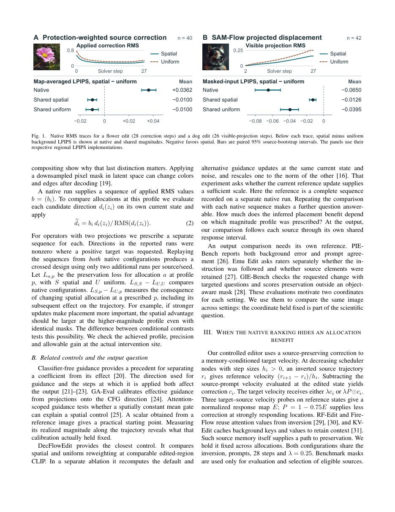
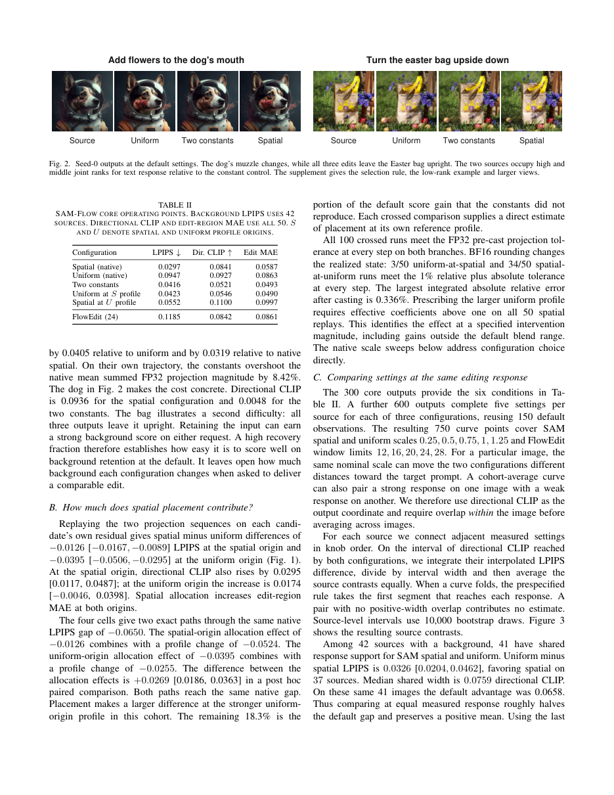
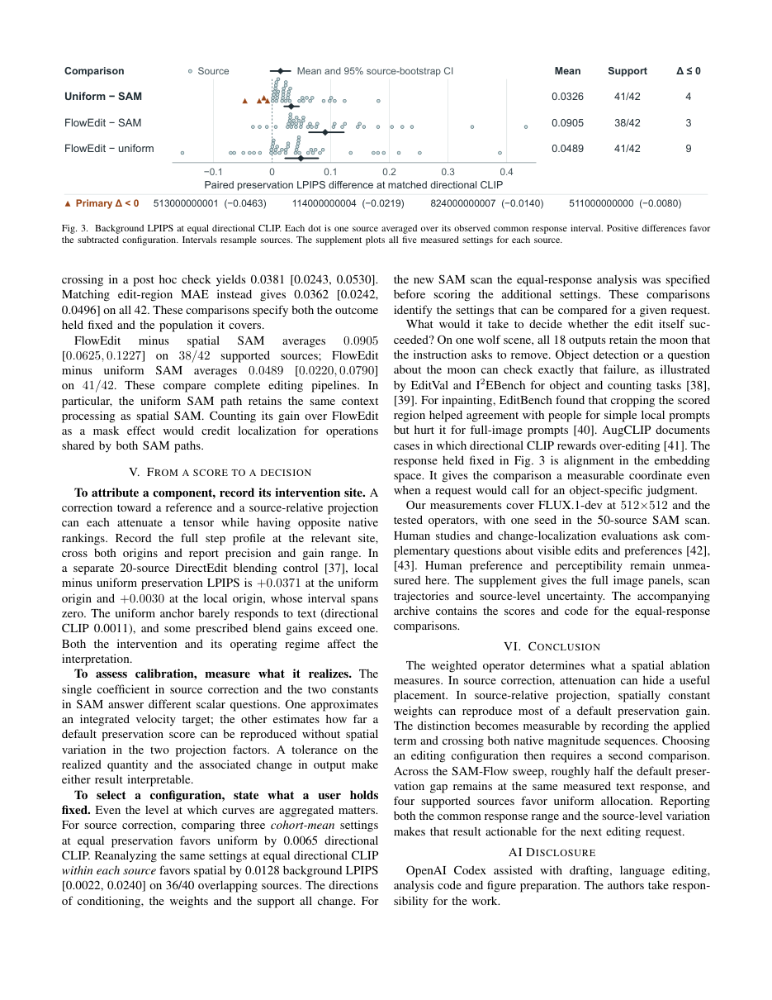

# A 论文 v18 审阅与改稿方案（只改写作 / 排版 / 作图，可补 CPU 评测）

> 历史研究备忘。下文保留写作时的假设、建议与旧版数值；已完成的实验和当前数字见 [v21 主文](../../manuscript/A_ICME_Main.pdf)。

> [!IMPORTANT]
> **一句话诊断**：v18 的**科学内容已经够 ICME**（两个算子、900 + 1920 张图、交叉回放、等响应比较都很扎实），但**故事是隐性的**。最漂亮的那个对称结论——**同一种“掩码削弱幅度”的混杂，在“恢复型”算子里会把真实收益藏起来，在“推离型”算子里会把收益夸大**——全文没有一句话、一张图把它直接摆出来。审稿人读完只会记住“很多数字 + 很多限定语”，记不住贡献。
>
> 改稿主轴：**① 把对称结论立成论文核心；② 给两套比较方法起名字、画成图，当作贡献；③ 加一个纯 CPU 的“局部化比例”指标，让标题问题 *Localized, or just lighter?* 直接可视化、可量化；④ 删内部黑话、降数字密度、统一术语；⑤ 图全部按同一套视觉规范重做。**

---

## 0. 现状快照（v18）

````carousel

<!-- slide -->

<!-- slide -->

````

| 维度 | 现状评分 | 主要问题 |
|---|---|---|
| 科学内容 | ★★★★☆ | 证据链完整；唯一大缺口是“编辑到底做没做成”没有人工或对象级检查 |
| 叙事 | ★★☆☆☆ | 没有贡献列表；核心对称结论只埋在正文里；Related Work 和方法混写，看不出“哪里是新的” |
| 表达 | ★★☆☆☆ | 句子短碎、反问多（“Do those constants also preserve the user's edit? Their instruction response drops.”）；每段 4–6 个带 CI 的数；同一概念有 4–5 种叫法 |
| 作图 | ★★☆☆☆ | 3 张图都在“展示数据”，没有一张在“讲结论”；没有方法示意图；缩略图太小；图中出现源 ID |
| 排版 | ★★★☆☆ | 版面利用尚可；但 Fig.1 两个面板用的 LPIPS 实现不同，图注还得专门解释；表里出现 “archived R88 evaluation” |

---

## 1. 叙事重构：讲一个审稿人记得住的故事

### 1.1 故事骨架（Anomaly → Mechanism → Tool → Rule）


**这条线的关键**：两个编辑器不是“我们恰好测了两个”，而是**按算子类型刻意选的两个对立样本**：

| | 恢复型（source correction，往源图拉） | 推离型（SAM-Flow projection，从源图推开） |
|---|---|---|
| 掩码 ∈ [0,1] 削弱了什么 | 削弱**保护力** → 背景更差 | 削弱**编辑位移** → 背景更好 |
| 默认开/关对比的偏差方向 | **低估**空间分配（真实收益被藏起来） | **高估**空间分配（多数收益来自“变轻”） |
| 证据 | 原生 +0.0362 → 匹配幅度后 −0.0100，**符号反转**；39/40 源原生判负 | 两个常数复现 **81.7%** 背景收益，代价是 dCLIP 从 0.084 掉到 0.052 |
| 匹配幅度/响应后剩下的真实分配效应 | −0.0100（两个参考轨迹一致） | −0.0126 / −0.0395（依赖参考轨迹）；等响应下 0.0326，37/41 |

> 这张表本身就该进正文（或做成 Fig.1 的右半边）。审稿人看到“同一个混杂、两个相反方向”，会觉得论文在讲规律，而不是两个 case study。

### 1.2 贡献怎么写（新增，放在 Intro 末尾）

把“我们做了什么”改写成“我们给社区提供了什么”，方法要**起名**：

1. **Diagnosis.** We show that a spatial mask changes both *where* and *how much* a flow editor intervenes (Eq. 1), and that the direction of the resulting bias depends on the masked operator: it **hides** a real placement gain when the mask weakens a source-restoring term, and **inflates** it when the mask weakens a source-departing term.
2. **Two lightweight protocols.** *Crossed Profile Replay (CPR)* attributes a component's effect at a prescribed intervention magnitude using two extra runs per source; *Matched-Response Comparison (MRC)* compares configurations over the response range each image actually reaches.
3. **Evidence on two FLUX editors (90 sources, 2,800+ outputs).** Sign reversal (+0.036 → −0.010 LPIPS); 81.7% of a published editor's default gain reproduced by two constants; half of its default gap surviving at matched response (37/41 sources); and an aggregation-level flip between cohort-mean and per-source analyses.
4. **A checklist** for reporting spatial ablations（再加一句 CPU 文献审计的结果，见 §3.3，冲击力会大很多）。

### 1.3 Abstract 重写示范（可直接替换后再微调数字）

> **Abstract** — Spatial editors in flow-based image editing are usually validated by switching their mask on and off at a default setting and reporting background preservation. We show that this ablation conflates *where* an editor intervenes with *how much* it intervenes: a mask in [0,1] also rescales the term it multiplies. The direction of this bias depends on what the mask weakens. In a source-correction editor, where the mask weakens a pull toward the source, the default ablation makes spatial allocation look harmful (uniform wins on 39/40 sources), yet matching the applied correction at every step reverses the ranking. In SAM-Flow, where the mask weakens a departure from the source, two spatially constant gains reproduce 81.7% of the default preservation gain while suppressing the requested edit. We introduce two inexpensive protocols: *crossed profile replay*, which attributes a component's effect at a prescribed intervention magnitude, and *matched-response comparison*, which compares configurations at the text response each image actually reaches. Under the latter, SAM-Flow's spatial allocation still preserves the background better on 37 of 41 sources, but the default gap halves. We conclude with a checklist for reporting spatial ablations.

**对比 v18 的变化**：首句先立常识靶子；第二句给机制；第三句点明“方向取决于算子”（核心新意）；两个工具有名字；结尾落到社区可用的准则。

### 1.4 Introduction 四段式

| 段 | 内容 | 用 v18 哪些素材 |
|---|---|---|
| ¶1 场景 + 常识靶子 | 戴头盔的狗叼花：保住头盔可能因为“编辑得准”，也可能因为“几乎没编辑”。社区用掩码开/关来证明定位有效 | 保留 v18 第一段（写得好），末尾加一句“几乎所有空间编辑器都这样做消融” |
| ¶2 机制 + 对称反常 | Eq.1 的直觉；恢复型 vs 推离型；两个 headline 数字 | v18 第三段的数字，加上 §1.1 那张表的逻辑 |
| ¶3 两个工具 | CPR 回答“组件贡献多少”，MRC 回答“用户该选哪个配置”；**两个问题需要两个参照** | v18 第四段，配上名字 |
| ¶4 贡献列表 | §1.2 的 3–4 条 | 新增 |

### 1.5 章节重排

| v18 | 建议 |
|---|---|
| II. What does a spatial ablation hold fixed?（相关工作 + Eq.1 + Eq.2 + 相关对照混在一起） | **II. Problem and Protocols**：A. Magnitude identity (Eq.1)；B. Crossed profile replay（Eq.2 + 2×2 分解式，见下）；C. Matched-response comparison（把 V-C 的积分定义挪到这里，写成 Eq.3）。**相关工作压缩成 II-D 一段或者放到 Intro 后，严格只写“他们做了什么 / 我们多了什么”** |
| III. When the native ranking hides an allocation benefit | **III. Case 1: Restoring operator — the confound hides a gain**（标题直接写结论） |
| IV. When a native preservation gain survives response matching | **IV. Case 2: Departing operator — the confound inflates a gain**（IV-C 的等响应比较单独升为 V） |
| V. From a score to a decision | **V. Matched-response comparison** + **VI. Checklist and limitations** |

建议显式写出的分解式（v18 正文用文字描述过，没写成公式）：

$$
\underbrace{L_{S,S}-L_{U,U}}_{\text{native gap}}
=\underbrace{(L_{S,S}-L_{U,S})}_{\text{allocation @ profile }S}
+\underbrace{(L_{U,S}-L_{U,U})}_{\text{profile effect}}
=\underbrace{(L_{S,U}-L_{U,U})}_{\text{allocation @ profile }U}
+\underbrace{(L_{S,S}-L_{S,U})}_{\text{profile effect}}
$$

一个式子把“两条路径、同一个 native gap”讲清楚，这是全文最该被记住的公式，Fig.1 也围绕它画。

---

## 2. 表达层面：逐条修改清单

### 2.1 必删（内部黑话 / 防御性细节，放正文会掉分）

| 位置 | 原文 | 处理 |
|---|---|---|
| Table I 表注 | “NATIVE SPATIAL EDIT MAE COMES FROM THE ARCHIVED R88 EVALUATION” | **删**。R88 是内部轮次编号 |
| IV-B 末段 | “All 100 crossed runs meet the FP32 pre-cast projection tolerance… BF16 rounding… 3/50… 34/50… 0.336%” | 正文压成一句：“Replayed profiles match their targets to within 0.34% (details in Supp.)” |
| Fig.3 图下 | “513000000001 (−0.0463) 114000000004…” | **删**。改成在图里用 4 个红三角标出，图注写“4 sources favor uniform; see Supp. Fig. Sx” |
| 多处 | “post hoc”, “prespecified”, “engineering check”, “uninstrumented adapted reference” | 正文保留 1 处说明哪些是预先指定的分析，其余移到补充材料 |
| II-A | “The identity pertains to this tensor. Other terms in the update, later states and the decoder determine…” | 合并成一句：“Eq. 1 describes the masked tensor only; its effect on decoded pixels is measured separately.” |
| Fig.1 图注 | “The panels use their respective regional LPIPS implementations.” | 用 §3.1 的 CPU 重算统一指标后删掉 |

### 2.2 统一术语（目前同一个概念最多有 5 种叫法）

| 概念 | 统一用词 | 不要再用 |
|---|---|---|
| “改哪里” | **allocation**（spatial / uniform allocation） | placement, localization, spatial weighting, spatial rule |
| “改多少” | **intervention magnitude**；逐步序列叫 **magnitude profile** | strength, energy, correction RMS（作为概念名时）, intervention |
| 回放的参考轨迹 | **reference profile S / U** | origin, profile origin, shared spatial/uniform, “U at N” |
| 两种算子 | **restoring operator / departing operator** | source-correction editor / projected displacement（第一次出现时括号注明即可） |
| 两个工具 | **CPR / MRC** | “two comparisons”, “the crossed design”, “equal-response analysis” |

> 900 张全图对照 PDF 里写的 “U at N / S at U” 与正文 Table II 的 “Uniform at S profile” 也要统一。

### 2.3 句子风格（去掉 Codex 腔）

| 问题 | v18 例句 | 改法 |
|---|---|---|
| 反问加短答 | “Do those constants also preserve the user's edit? Their instruction response drops.” | “These constants, however, suppress the requested edit: directional CLIP falls from 0.084 to 0.052 (Table II).” |
| 一句一个事实，缺少因果连接 | II-B 整段 | 每段首句写结论（topic sentence），后面用 *because / therefore / whereas* 串起来 |
| 数字过密 | IV-B 一段 9 个数 | 正文每段**最多 2 个带 CI 的数**，其余进表格；CI 只给 headline 结果 |
| 过度限定 | “in this cohort”, “in a post hoc paired comparison”, “roughly” 反复出现 | 统一在 Limitations 里说一次适用范围，正文不再每句都加 |

### 2.4 效应量怎么讲得有分量

LPIPS 差 0.01 看起来很小，换成相对量审稿人更容易接受：
- “matching magnitude flips the sign and recovers **28%** of the native gap in the opposite direction”（−0.0100 / +0.0362）；
- “constants reproduce **82%** of the gain at **38%** lower text response”；
- 再配上 §4 的变化热图，让读者亲眼看到 0.03 LPIPS 的差别长什么样。

---

## 3. 只用 CPU 的补充评测（按性价比排序）

> [!TIP]
> 这些都只用已有 PNG、掩码和分数文件。**SAM 队列 900 张原生图都在**；源修正队列只存了 160 张主对照原生 PNG，其余只有分数，所以像素级新指标以 SAM 队列为主，源修正用这 160 张做补充。

### 3.1 统一区域 LPIPS 的实现（半天，必须做）
用同一个实现（建议沿用 SAM 队列的“区域外置黑 + AlexNet-v0.1”，或特征图掩码平均）把两个队列重算一遍，Fig.1 和全文只报一种。两种实现的结果都放进补充材料表格，作为稳健性检查。这样能**删掉图注里那句最招质疑的话**。

### 3.2 新指标：局部化比例（1 天，强烈推荐，直接回答标题）
对每张输出 $\hat x$ 和源图 $x$，令 $\Delta=|\hat x-x|$，编辑掩码为 $M$：

$$
\underbrace{\textstyle\sum_{p\notin M}\Delta_p}_{\text{background change}}
=\underbrace{\textstyle\sum_p \Delta_p}_{\text{total change (how much)}}\times\Big(1-\underbrace{\tfrac{\sum_{p\in M}\Delta_p}{\sum_p\Delta_p}}_{\text{localization ratio }\rho\ \text{(where)}}\Big)
$$

这是 Eq.1 在**输出像素空间**的对应物：背景变化 = 总变化量 × 落在背景的比例。
- **预期**：两个常数主要把“总变化量”压低，ρ 和 uniform 差不多，也就是“**just lighter**”；空间分配则提高 ρ，也就是“**localized**”。
- 能画出全文最好看的一张图（§4 Fig.4c）：横轴总变化量、纵轴 ρ，每种配置一团点，箭头表示“变轻”与“变局部”两个方向。**标题问题第一次有了一个可以直接读数的坐标系。**
- 像素差可以在 RGB 上算，也可以用 LPIPS 空间图；建议两种都算，主文报一种。

### 3.3 文献审计（1–2 天读论文，无计算，冲击力最大）
统计 2023–2026 年 20–30 篇带空间掩码 / 门控消融的编辑论文（DiffEdit、MasaCtrl、KV-Edit、DecFlowEdit、VeloEdit、InstantEdit、FlowChef、SAM-Flow、Attention-scoped guidance……），按三类记录消融做法：
① 固定系数开/关；② 匹配某种幅度；③ 匹配编辑响应或画出前沿曲线。

一句 “**N of M papers ablate their spatial component at a single default coefficient**” 能让论文从“两个案例”升级成“影响整个社区的方法论问题”。做成一张小表或条形图，放 Intro 或 Sec VI。
> 只统计论文里明确写出的做法，拿不准的单独归为“未说明”，不要硬分类。

### 3.4 编辑是否成功：小规模人工核对（半天，堵住最大的审稿漏洞）
v18 自己承认 “human preference remains unmeasured”，月亮那个例子也说明 dCLIP 会误判。建议：
- 50 源 × 3 配置（spatial / uniform / two constants）= 150 张默认输出，2–3 人**盲评**一个二元问题：“指令要求的变化是否出现？”
- 报告成功率和评分者一致性（Cohen's κ / Fleiss' κ）。
- 预期结论：常数配置的成功率明显更低。这样“常数复现 82% 背景收益但编辑没做成”就不再只靠 dCLIP 支撑。

### 3.5 可选
- 背景区 PSNR / SSIM / DINO 作为第二指标进补充材料，证明结论不依赖 LPIPS。
- MRC 改用 ρ 或编辑区 MAE 当响应坐标，做敏感性分析（v18 已有 MAE 版本，可以合并成一张小表）。

---

## 4. 作图方案：要画哪些图、每张讲什么

### 4.1 统一视觉规范（去掉“AI 味”的关键）

| 规则 | 具体做法 |
|---|---|
| 一图一结论 | 图注**第一句就是结论**，例如 “Masking hides a gain in a restoring operator but inflates one in a departing operator.” |
| 固定配色，全文一致 | Okabe-Ito 色盲友好：**spatial = #0072B2（蓝）**、**uniform = #D55E00（朱红）**、**two constants = #7F7F7F（灰）**、**FlowEdit = #009E73（绿）**。不用渐变、阴影、圆角卡片、图标 |
| 字体与尺寸 | 按最终尺寸作图：单栏 3.5 in、通栏 7.16 in；字号 7–8 pt，与正文字体一致（Times 或统一 Helvetica）；导出**矢量 PDF** |
| 直接标注 | 能在曲线旁写名字就不用图例；去掉网格和多余边框（只留左、下坐标轴） |
| 真实数据 | 每个点、每张缩略图都来自实际输出；放大框用细线框，标出原图位置 |
| 面板标签 | 统一用 IEEE 风格 (a)(b)(c)，左上角，粗体 |
| 不放源 ID | 需要指认个例时，用标记形状加图注描述 |

matplotlib 起步配置（全文所有图共用一个 `style.py`）：

```python
import matplotlib as mpl
mpl.rcParams.update({
    "font.family": "serif", "font.serif": ["Times New Roman"], "font.size": 7.5,
    "axes.linewidth": 0.6, "axes.spines.top": False, "axes.spines.right": False,
    "xtick.major.width": 0.6, "ytick.major.width": 0.6, "lines.linewidth": 1.1,
    "legend.frameon": False, "pdf.fonttype": 42, "savefig.bbox": "tight", "savefig.pad_inches": 0.01,
})
C = dict(spatial="#0072B2", uniform="#D55E00", const="#7F7F7F", flowedit="#009E73")
```

### 4.2 建议的主文图表（5 图 2 表，正好 6 页）

| 编号 | 尺寸 | 内容 | 讲的结论 | 数据来源 |
|---|---|---|---|---|
| **Fig.1 Teaser** | 单栏，第 1 页 | **2×2 交叉分解方块**：横轴 allocation（U→S），纵轴 reference profile（U→S），四个角标 LPIPS；对角线是 native gap，两条折线路径分别标 “profile effect” 和 “allocation effect”。左右两个小方块分别画 Case 1 和 Case 2，**一个对角箭头朝上、一个朝下** | 同一个混杂，两个相反方向 | Table I / II 已有数字 |
| **Fig.2 Protocols** | 单栏 | (a) Eq.1 示意：同直方图的两张 map 与 $v_i$ 对齐方式不同 → 衰减不同（3 个小方格示意即可）；(b) 原生 S/U 的 RMS 曲线与回放曲线重合（沿用 v18 Fig.1 的曲线，去掉花和狗）；(c) MRC 示意：一个源的 LPIPS–dCLIP 两条折线、阴影标出共同响应区间、箭头标出积分差 | 两个工具分别控制什么 | 已有 core_steps.csv、scan scores |
| **Fig.3 Qualitative + change maps** | 通栏 | 3 行（高、中、低响应各 1 个源）× 4 列（Source / Uniform / Two constants / Spatial）；每张图下方配**变化热图** $\Delta$（同一色标，叠加编辑掩码轮廓），右下角标该图的 bg-LPIPS / dCLIP；编辑区加放大框 | 常数是“整体变轻”，空间是“变化集中到目标区” | 900 张 PNG + PIE 掩码，**CPU 生成** |
| **Fig.4 Matched response** | 通栏 | (a) 每源 default gap vs matched gap 散点，加 y=x 和 y=x/2 两条参考线，点按类别着色；(b) 三个比较的源级分布（保留 v18 Fig.3 的条带，但删 ID、加中位数）；(c) **局部化平面**：横轴总变化量、纵轴 ρ，四种配置的均值和 95% 椭圆，箭头标注 “lighter” 与 “localized” | 等响应下真实优势约为默认的一半；“lighter”和“localized”两个方向可以分开 | scan_per_source.csv + §3.2 |
| **Fig.5 Aggregation trap**（可与 Fig.4 合并，或放补充材料） | 单栏 | 源修正三档扫描：左边是群体均值曲线（看起来 uniform 更好），右边是逐源配对差（spatial 在 36/40 源更好） | 聚合层级本身会翻转结论 | three_scale_points.csv |
| **Table I（合并）** | 通栏或单栏 | 两个算子放一张表：Native S、Native U、标量/常数控制、两个 CPR 回放；列为 bg-LPIPS、dCLIP、Edit MAE，外加一列 “allocation effect”。**Case 1 / Case 2 用中间横线分组** | 一眼对照两个案例 | Table I + II 合并 |
| **Box: Checklist** | 单栏，Sec VI | 3 条准则（Record the site / Measure what calibration realizes / State what is held fixed），每条一行，附“对应证据”的节号 | 社区可以直接拿走的产出 | v18 Sec V 加粗句 |

### 4.3 每张图的“禁忌”与“必须”

- **Fig.1**：不要画流程框图（那是方法论文的套路）。分析论文的 teaser 应该是**一个让人看一眼就懂的反常结果**。四个角放数字，箭头粗细按效应大小画。
- **Fig.3**：缩略图至少 1.6 cm 宽；热图统一用单色顺序色表（如 `Greys` 或 `viridis`），色标固定区间，放一个共享 colorbar；**不同面板不要各自归一化**，否则不可比。
- **Fig.4c**：这是全文唯一能直接回答标题的图，值得精修：等高线标出“背景变化 = 常数”，读者能看出常数配置是沿着等高线往“变轻”方向滑过去的。
- 所有图都不要放标题栏（v18 Fig.1 的 “A Protection-weighted source correction” 这类大字标题删掉，信息放进图注）。

---

## 5. 版面规划（IEEE 双栏，正文 6 页；参考文献是否另计以 ICME 2027 CFP 为准）

| 页 | 内容 |
|---|---|
| 1 | 标题、摘要、Intro ¶1–¶3、**Fig.1（右栏底部或顶部）** |
| 2 | Intro ¶4 贡献、II. Problem & Protocols（Eq.1、分解式、Eq.2、Eq.3）、**Fig.2** |
| 3 | II-D 相关工作（短）、III. Case 1、**Table I（合并）** |
| 4 | IV. Case 2、**Fig.3（通栏，页顶）** |
| 5 | V. Matched response、**Fig.4（通栏，页顶）** |
| 6 | VI. Checklist（Box）+ Limitations + Conclusion + AI Disclosure |
| 7 | References（如果 CFP 允许单独一页；否则压到 30 篇左右） |

**补充材料**放：900 张全图对照、FP32/BF16 容差、post hoc 分析、所有 CI 表、两种 LPIPS 实现的稳健性对比、DirectEdit 对照、文献审计明细。

---

## 6. 审稿人可能的质疑与预先回应

| 质疑 | 现在能怎么回应 |
|---|---|
| “只有 FLUX.1-dev，SAM 只有 1 个 seed” | Limitations 写明；强调两类算子覆盖了偏差的两个方向，这是论证所需的最小设计 |
| “dCLIP 不可靠，‘编辑成功’没验证” | §3.4 的人工盲评 + §3.2 的 ρ |
| “纯分析，没有方法” | 两个有名字的工具 + 检查清单 + 文献审计；ICME 接受分析类论文，关键是让贡献可复用 |
| “效应量很小” | 换算成相对量（§2.4）+ Fig.3 变化热图 |
| “为什么选这两个编辑器” | 一个是恢复型、一个是推离型，按算子类型选，不是随便挑的 |
| “与 DecFlowEdit 的 norm-rescaling 对照有何不同” | v18 II-B 已经写清（单步当前状态 vs 整条另一原生轨迹的逐步序列，并且两个方向交叉）；建议压成一句放进贡献 2 |

---

## 7. 执行顺序（约 6–7 个工作日）

| 天 | 任务 | 产出 |
|---|---|---|
| D1 | §3.1 统一 LPIPS 重算；§3.2 计算 ρ 和总变化量 | 新的 per-source CSV |
| D2 | §3.4 人工盲评（找 2 位同学，每人约 1 小时）；同时开始 §3.3 文献审计 | 成功率、κ；审计表初稿 |
| D3 | 按新骨架重写 Abstract / Intro / Sec II（术语表先定稿） | 正文前半 |
| D4 | 做 Fig.1、Fig.2、合并后的 Table I | 3 个图表 |
| D5 | 做 Fig.3（热图）、Fig.4（含局部化平面） | 2 张通栏图 |
| D6 | 改写 Sec III–VI、Checklist box；清理黑话和数字密度 | 完整稿 |
| D7 | 通读：每张图注首句是不是结论、每段首句是不是论点、术语是否统一；整理补充材料 | 投稿版 |

> [!NOTE]
> 有两点需要你本地确认：① SAM 队列 900 张原生 PNG 和 PIE-Bench 掩码在本机的路径（§3.2 / Fig.3 需要）；② ICME 2027 CFP 对页数和参考文献是否单独计页的规定。
