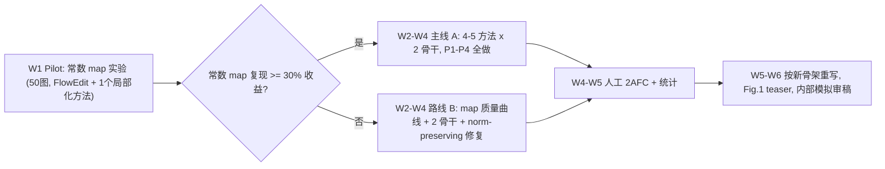

# 论文大改方案：从"一个编辑器内的条件归因"到"Dose Illusion"

> 历史研究备忘。下文保留写作时的假设、建议与旧版数值；已完成的实验和当前数字见 [v21 主文](../../manuscript/A_ICME_Main.pdf)。

> [!IMPORTANT]
> **时间约束**：ICME 2027 官网（2027.ieeeicme.org）显示 **Regular Paper 截稿时间为 2026-12-30 AoE**，今天距截稿约 6 周。时间足够做一次叙事和实验上的大改，但必须在第 1 周用一个 pilot 实验决定走哪条路线（见 §7）。

---

## 1. 我调研了什么

| 类型 | 来源（✅ 已在线读取原文；📚 来自我的背景知识，原页面无法访问） |
|---|---|
| 分析类顶会论文 | ✅ *Guidance Matters*（ICLR'26, arXiv 2602.22570）· ✅ *Are Emergent Abilities a Mirage?*（NeurIPS'23 Outstanding）· ✅ *A Metric Learning Reality Check*（ECCV'20）· ✅ *Vision Transformers Need Registers*（ICLR'24 Outstanding）· ✅ *Implementation Matters in Deep Policy Gradients*（ICLR'20）· ✅ *Deep RL that Matters*（AAAI'18）· ✅ *Common Diffusion Noise Schedules are Flawed*（WACV'24）· ✅ *Direct Inversion / PIE-Bench*（ICLR'24）· ✅ *EDM*（NeurIPS'22）· ✅ *ConvNeXt*（CVPR'22）· ✅ *Guidance Interval*（NeurIPS'24）· ✅ *Rethinking FID*（CVPR'24）· ✅ *Massive Activations*（COLM'24） |
| 同领域最新工作（竞品/靶子） | ✅ DecFlowEdit（2609.34237）· ✅ SAM-Flow（2606.06228）· ✅ VeloEdit（2603.13388）· ✅ *Editing on the Generative Manifold*（2603.29736，编辑权衡理论）· FlowSlider（连续强度控制） |
| 大佬方法论 | ✅ Michael Black《Novelty in Science》· ✅ 黄嘉彬（Jia-Bin Huang）awesome-tips / paper-writing · ✅ Hamming《You and Your Research》· ✅ Karpathy《PhD Survival Guide》· ✅ 知乎"科研讲故事"系列（检索摘要）· 📚 Simon Peyton Jones《How to write a great research paper》· 📚 Bill Freeman 的 CVPR 写作建议（Twitter / 知乎正文被拦截，PDF 无法解析） |

---

## 2. 顶会分析论文走的 5 条路线

| 路线 | 代表作 | 故事公式 | 让论文"值钱"的关键动作 |
|---|---|---|---|
| **R1 Reality Check / 评测陷阱** | Metric Learning Reality Check；Deep RL that Matters；**Guidance Matters (ICLR'26)**；Rethinking FID | 领域宣称在进步 → 我们发现一个混杂因素 → 提出公平协议 → **重测 N 个方法** → 大部分收益消失 → 给出规范 | 广度：重测多个已发表方法。Guidance Matters 还**专门造了一个"假方法 TDG"**：它在旧评测下大幅领先，实际却无效，这是最有杀伤力的修辞。 |
| **R2 Mirage / 替代解释** | Emergent Abilities Mirage | 大家相信现象 P → 一个**简单数学模型**给出替代解释 → 推出**可证伪预测** → 逐条验证 → 甚至能**按需制造**这个现象 | 简单模型、预测、验证、按需制造，四步缺一不可。 |
| **R3 现象 → 机制 → 极简修复** | ViT Registers；Massive Activations；Noise Schedules Flawed；Direct Inversion（"3 行代码"）；DecFlowEdit | 观察到一个反常现象 → 解释其机制 → 提出几行代码的修复 → 在多个模型上带来提升 | 修复必须极简，而且必须带来性能提升。 |
| **R4 收益归因** | **Implementation Matters (ICLR'20)**：PPO 相对 TRPO 的大部分收益其实来自代码级技巧 | "X 的收益并不来自它声称的机制，而是来自被忽视的 Y" | 量化"Y 解释了多少比例的收益"。 |
| **R5 设计空间梳理 → 新 SOTA** | EDM；ConvNeXt；Guidance Interval | 把纠缠的设计拆成正交维度 → 逐个扫描 → 组合出新 SOTA | 最后要落到 SOTA 上。 |

**五条路线的共同点（也是你现在缺的）：**
1. 明确点名一个**领域普遍相信的东西**（belief）。
2. 有一句话就能说清的**反直觉结论**。
3. **跨多个方法或模型**的证据广度。
4. 一个**可直接拿去用的产出**：协议、指标或几行代码的修复。
5. 简单。Michael Black 说："Novelty 应该换成 *beauty*，审稿人常把复杂、困难、技术性误当成新颖性。"

---

## 3. 大佬们怎么讲故事、找创新点（提炼成可执行的规则）

| 规则 | 出处 | 对你意味着什么 |
|---|---|---|
| 新颖性 = 一种**新的看问题的方式**，不等于复杂度。"显而易见"要在想法出现*之前*评判。 | Michael Black | 式 (1) 的范数恒等式本身就是一个"新视角"，但你把它写成了一行附注。它应该成为全文的"透镜"。 |
| 做**重要的问题**；问自己"我领域里最重要的问题是什么，我为什么不在做它？" | Hamming | "单个编辑器里的条件归因"不重要；"整个 localized editing 浪潮的收益是不是真的"才重要。 |
| **一篇论文只讲一个 idea**，能用一句话说清；先写论文再做实验；贡献要写成**可被反驳的 claim**。 | 📚 Peyton Jones / Freeman | 现在的论文有 3 个"发现"、7 个对照、5 个检验族，读者抓不到一个 idea。 |
| **不要让读者做对应题**：一表一结论，符号要有名字，图注自包含，避免缩写。 | 黄嘉彬 | REQ / U25 / GLB-R / REQ-U / SC / SHUF-R / REV-R / SOURCE-R / RAND 全部要删掉或改成语义名称。 |
| 故事结构：**背景 → 冲突 → 主角 → 情节 → 主题**；审稿人的共鸣始于认同"问题价值"，而不是数据。 | 知乎"科研讲故事"系列 | 你现在的论文全是"情节"（统计），没有"冲突"（谁错了？错在哪？）。 |
| 先找"大家都在用却没人质疑的默认做法"。 | Guidance Matters / Mirage / Implementation Matters 的共同起点 | 这里的默认做法是：**同系数比较带空间权重和不带空间权重的方法**。 |

---

## 4. 诊断：你手里其实有一张好牌，只是打法错了

**你真正的资产：**
1. **式 (1)：** 任何 ≤1 的空间权重 P，都会把加性更新的范数悄悄缩小到 √e(P) 倍。这是一个**可预测的简单数学模型**，正好是 R2 Mirage 路线需要的核心。
2. **MMCP 的逐步自状态回放：** 回放精度 2e-7，并且已证明一次性标量校准会偏 4%、使效应偏 0.006。这是一个现成的**公平比较工具**。
3. **一个"双向"实证：** 在你的设置里，空间权重作用于*修正项*，混杂因素让空间分配**看起来有害**（+0.036），匹配后**实际有益**（−0.010）。
4. **Pareto 结果：** 你的 map 在前沿上被 uniform 支配。这说明"匹配剂量后有益"≠"值得用"，并且暗示**map 质量**才是决定因素（补充材料 Fig. S11 的 AUROC 关联已经露出苗头）。

**错在哪：** 你把一个"全领域的评测透镜"讲成了"一个自建编辑器内部的条件估计量"。审稿人看到的是：一个编辑器、40 张图、0.01 LPIPS，外加大量对冲语句。

---

## 5. 新主线（主推）：*Localized, or Just Lighter? The Dose Illusion in Training-Free Flow Editing*

### 5.1 一句话故事
> **2025–26 年涌现了一批"局部化"flow 编辑方法（DecFlowEdit、SAM-Flow、VeloEdit、ASG、V2C-Edit 等），它们用空间权重重新加权速度或修正项，并报告了大幅的背景保持提升。但任何空间权重都会悄悄改变更新的"剂量"。我们证明：剂量这个混杂因素既能“制造”虚假的局部化收益，也能“掩盖”真实的收益；并给出把二者分开的协议。**

### 5.2 冲突（belief vs. 反直觉结论）
- **Belief：** 背景 LPIPS 降低 = 方法更好地定位了编辑区域。
- **反直觉结论：** 一部分（可能是大部分）收益只是"编辑得更轻了"。一个**完全不做定位的常数 map** 就能复现相当比例的"局部化收益"。
- **双向性：** 你原有的实验正好是反方向的例子，混杂因素让一个真实有益的空间分配看起来有害。双向证据让论点从"挑刺"升级为"机制"。

### 5.3 Mirage 式可证伪预测（由式 (1) 推出）
| 预测 | 实验 | 若成立，标题级结论 |
|---|---|---|
| **P1 假方法：** 常数 map P≡p（零定位）在 PIE-Bench 标准单点表格上也能"超过"基线 | 把 p 设成与某方法相同的平均剂量；直接沿用其论文的表格格式 | "一个不做任何定位的 map 复现了 X% 的报告收益"（这就是 Guidance Matters 的 TDG 套路） |
| **P2 剂量可预测收益：** 在不同方法和图像之间，传统评测下的收益与剂量缩减 1−√e(P) 强相关 | 逐图记录 e_i(P)，做回归 | "仅凭剂量就能解释 R² = Y 的收益方差"（这就是 Implementation Matters 式的归因比例） |
| **P3 匹配后收缩：** 在剂量匹配（MMCP）或前沿比较下，收益缩小，剩下的才是真实的定位效应 | 每个方法做 native / uniform-at-matched-dose / 强度扫描三组 | "N 个方法中 K 个的收益缩小超过 Z%" |
| **P4 map 质量阈值：** 真实定位收益随 map 与 GT 编辑区的对齐度（AUROC）单调上升，低于某个阈值时 uniform 占优 | 受控 map 族：GT mask → 逐级加噪或模糊 → 随机 → 反转，并把各方法自带的 map 放到同一条曲线上 | "定位只有在 AUROC > τ 时才划算"。这是一个**可迁移的规律**，也正好解释了你当前 map 被 uniform 支配的原因 |

### 5.4 可直接用的产出
1. **Dose-aware evaluation protocol**：① 报告实际施加的剂量；② 用自状态逐步回放做剂量匹配比较（你的 MMCP，并且你已证明一次性标量校准不够准，这成了工具的卖点）；③ 报告强度扫描下的"保持–编辑"前沿，以及一个标量指标（如 *preservation at matched CLIP* 或前沿下面积）。
2. **一行代码修复（R3 式彩蛋）：** *norm-preserving localization*，即把加权后的更新重新归一化到 uniform 的剂量（就是你的式 (2)）。这样空间权重只负责"重新分配"、不改变"总量"，所有收益都变成真实的定位收益，再暴露一个独立的剂量旋钮。如果它在高质量 map 上扩展了前沿，你就同时有了"分析 + 修复"。

### 5.5 实验设计（6 周可完成的规模）
| 维度 | 设置 |
|---|---|
| 方法 | 4–5 个**有开源代码**、核心是"空间加权的加性更新"的方法：FlowEdit（作为无定位基线，带强度旋钮 n_max）、SAM-Flow（已开源）、KV-Edit（mask 混合）、DecFlowEdit / VeloEdit（需确认代码）、DirectEdit blend（你已经实现），以及你自己的编辑器（作为"反方向"的案例） |
| 骨干 | FLUX.1-dev 加 SD3.5（DecFlowEdit 也是这么做的，审稿人会认可） |
| 数据 | PIE-Bench：每类 20 张、共约 200 张做分层子集；主表时间允许就跑全部 700 张 |
| 每个方法的臂 | native / 常数 map（P1）/ uniform@匹配剂量（P3）/ 强度扫描 5 档（前沿） |
| 人工评测 | 剂量匹配条件下的 2AFC，3 人，约 150 对 |
| 统计 | 保留你的严谨做法（源级 bootstrap 和 sign-flip），但**主文只报告效应 + CI**，其余全部移到补充材料 |

**算力粗估：** 200 图 × 约 8 臂 × 5 方法 × 2 骨干 ≈ 1.6 万张。FLUX 在 512 分辨率下约 5–10 s/张，合计约 25–45 GPU 小时，6 周内完全可行。

### 5.6 论文骨架（ICME 6 页）
| 节 | 页数 | 内容 |
|---|---|---|
| 1 Intro | 0.8 | 钩子："定位还是变轻？"→ belief → 式 (1) 的透镜 → 双向混杂 → 四个预测 → 贡献 |
| 2 Dose lens | 0.6 | 式 (1) 推广到所有"空间加权的加性更新"（速度重加权、修正项、latent 混合），给出剂量定义和两种公平比较（剂量匹配、前沿） |
| 3 A controlled case where the confound *hides* a benefit | 0.8 | **你原论文的全部核心结果压缩到这里**：2×2 四格、+0.036 → −0.010、标量校准的偏差 |
| 4 Re-evaluating localized flow editors | 1.5 | P1（常数 map 假方法）、P2（剂量回归）、P3（N 个方法匹配后收缩），一张主表加一张前沿图 |
| 5 When does localization pay off? | 0.8 | P4 map 质量曲线，加 norm-preserving 修复 |
| 6 Guidelines & limits | 0.3 | 一张 checklist 表（替代现在的 Table II） |
| Refs | 0.6–1 | 按 ICME 规则 |

**Fig. 1（teaser）三联图：**
- (a) 传统单点表格：局部化方法"赢了"；
- (b) 常数 map（零定位）也"赢了"；
- (c) 前沿图揭示真相：哪些方法真正把前沿往外推了。

### 5.7 摘要草稿（约 150 词，供参考）
> *Training-free flow editors increasingly localize edits by spatially reweighting velocity or correction fields, and report large gains in background preservation. We show that such gains are confounded: any spatial weight bounded by one silently rescales the applied update by an energy-alignment factor, so “editing locally” and “editing less” are indistinguishable under standard single-point evaluation. This confound is bidirectional: in a controlled FLUX editor it makes a beneficial spatial correction appear harmful, while across [N] recent localized editors a constant, location-agnostic weight reproduces [X]% of their reported preservation gains. A dose-matched replay protocol and preservation–fidelity frontiers separate genuine localization from dose, revealing that [K] of [N] methods retain a real benefit and that localization pays off only when the weight map’s alignment with the edited region exceeds [τ]. We release the protocol as a drop-in evaluation tool.*

方括号里的数字由 pilot 和正式实验填入。**不要先写数再找证据。**

> [!WARNING]
> **语气是生死线。** 定位为 *disentangling*（拆分）而不是 *debunking*（揭穿）。被你重测的方法的作者很可能就是审稿人。写"K 个方法保留了真实收益"比写"大部分方法是假的"安全得多。Metric Learning Reality Check 当年也因语气受到过反弹。

---

## 6. 备选路线（如果 pilot 不支持主线）

| 路线 | 一句话 | 优点 | 风险 |
|---|---|---|---|
| **B. When does spatial localization pay off?**（R3 + R5） | 以 P4 的 map 质量曲线为主角：剂量匹配后，定位收益是 map 对齐度的函数，并给出阈值和 norm-preserving 修复 | 不依赖"揭穿"别人，只用你自己的编辑器加受控 map 族就能做，工程量最小 | 广度仍然有限，需要至少在第二个骨干上复现曲线 |
| **C. PIE-Frontier：剂量扫描评测基准**（R1 偏 benchmark） | 给 10 个以上编辑器跑强度扫描，发布前沿排行榜，同时揭示单点排名不稳定 | ICME 很欢迎 benchmark 类工作，结论稳 | 新颖性偏弱，工程量最大 |
| **D. Dose-decoupled editing**（纯方法） | 把"方向（在哪）"和"剂量日程（多少、何时）"解耦，优化剂量日程，冲击 SOTA 前沿 | 有 SOTA 就最好卖 | 6 周内拿到 SOTA 的不确定性最高 |

**推荐：** 主线 A，把 B 的 map 质量曲线作为 §5，把 C 的前沿协议作为工具贡献。这样即使 P1/P3 的"假收益"比例不大，论文也能靠 P4 规律加协议立住。

---

## 7. 六周计划（截止 2026-12-30）

| 周 | 任务 | 交付物 / 判断点 |
|---|---|---|
| W1（11/17–11/23） | ① 跑通 FlowEdit 和 1 个局部化方法的代码，加 hook 记录每步的 e_i(P)；② pilot：在 50 张图上比较 native、常数 map、强度扫描；③ **先写 1 页 intro 和 Fig. 1 草图**（先写论文再做实验） | **Go / No-go**：常数 map 复现的收益比例；前沿是否分离 |
| W2–W3 | 扩到 4–5 个方法、200 张图、FLUX；受控 map 族（P4） | 主表初版、前沿图、剂量回归 |
| W4 | SD3.5 复现关键结果；norm-preserving 修复 | 第二骨干的一致性 |
| W5 | 人工 2AFC（3 人、约 150 对）；补充材料整理（**按问题组织，删除 R88–R92 等内部代号**） | 人工结果 |
| W6 | 按 §5.6 重写；用你上一轮的审稿意见做一次自审；请一位没参与项目的同学用 10 分钟读 Fig. 1 加摘要，看能否复述出那一句话 | 投稿 |

---

## 8. 写作上立刻能做的事（无论选哪条路线）

1. **一句话测试：** 写不出"我们证明了 ___"这一句话，就先别写正文。
2. **全文只用 2 个指代：** *dose*（剂量）和 *allocation*（分配）。所有臂名都改成"方法 @ 剂量"，例如 `Uniform@matched`、`Const-map`、`Localized@native`。
3. **数字纪律：** 摘要最多 3 个数字，正文统一保留 2 位有效数字，p 值只在表里出现。
4. **一表一结论、图注自包含**（黄嘉彬）：主文最多 1 张主表加 2 张主图。
5. **把"对冲"集中到 Limitations 一段**，正文用肯定句陈述已验证的结论。
6. **原论文里最该保留的三样东西：** 式 (1)、2×2 分解（式 (4)）、标量校准偏差的结果。其余统计细节全部移到补充材料。
